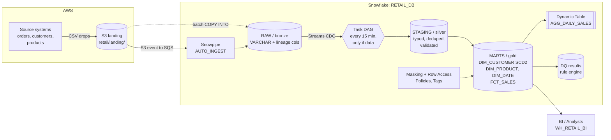
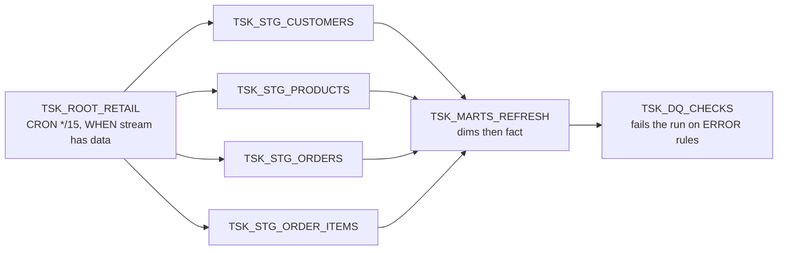
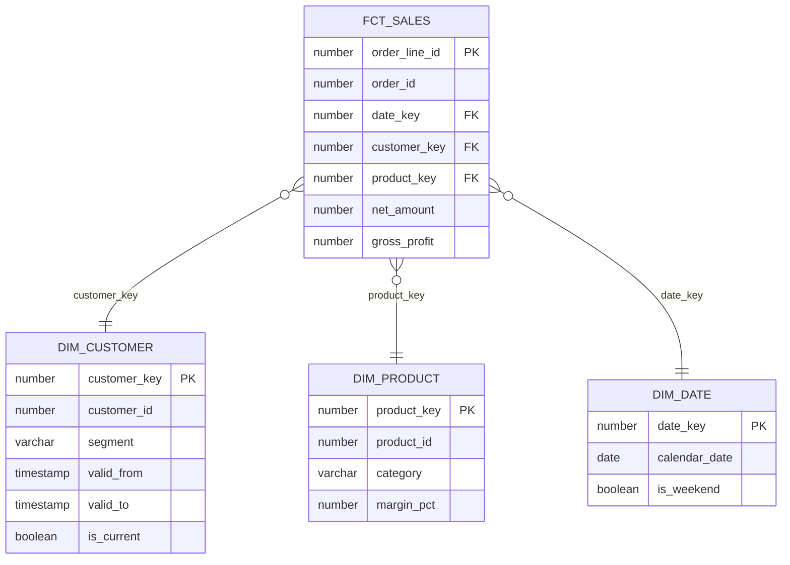

# Snowflake Retail Lakehouse: Medallion Architecture with CDC, SCD2 and Governance


An end-to-end, production-style e-commerce data platform built natively on Snowflake.
Raw files land in S3, stream into Snowflake with **Snowpipe**, are processed incrementally
with **Streams + Tasks**, and are modeled into a **star schema** with a **Type 2 slowly
changing dimension**, a metadata-driven **data quality framework**, **masking / row access
policies**, and **cost guardrails**.

> **See the output without a Snowflake account:** [`docs/sample_output.md`](docs/sample_output.md)
> shows the gold-layer results produced from the sample data in [`data/raw/`](data/raw).

---

## Architecture



### Task DAG



### Star schema



---

## What this project demonstrates

| Area | Implementation | File |
|---|---|---|
| **Security & RBAC** | Functional roles, managed-access schemas, least privilege, future grants | [`sql/00_setup`](sql/00_setup) |
| **Workload isolation** | Separate load / transform / BI warehouses; multi-cluster BI warehouse | [`01_rbac_and_warehouses.sql`](sql/00_setup/01_rbac_and_warehouses.sql) |
| **Secure ingestion** | Storage integration (IAM role trust, no keys), external + internal stages | [`01_storage_integration_and_stage.sql`](sql/01_ingestion/01_storage_integration_and_stage.sql) |
| **Batch + streaming** | Idempotent `COPY INTO` with lineage metadata; Snowpipe auto-ingest | [`sql/01_ingestion`](sql/01_ingestion) |
| **Incremental CDC** | Append-only Streams consumed by a conditional Task DAG | [`sql/02_staging`](sql/02_staging) |
| **Idempotency** | `MERGE` + `QUALIFY ROW_NUMBER()` dedupe, so replayed files never double count | [`03_tasks_incremental_merge.sql`](sql/02_staging/03_tasks_incremental_merge.sql) |
| **SCD Type 2** | History derived from a change log, stable surrogate keys, late-data tolerant | [`01_dimensions.sql`](sql/03_marts/01_dimensions.sql) |
| **Point-in-time joins** | Facts join the customer version valid *at order time* | [`02_fact_and_aggregates.sql`](sql/03_marts/02_fact_and_aggregates.sql) |
| **Dynamic Tables** | Declarative aggregate with 30-minute target lag | same |
| **Data quality** | Rule table + Snowflake Scripting engine; ERROR rules fail the DAG | [`01_dq_framework.sql`](sql/04_data_quality/01_dq_framework.sql) |
| **Governance** | Email masking, mapping-table row access policy, PII tags | [`sql/05_governance`](sql/05_governance) |
| **FinOps & observability** | Resource monitor, statement timeouts, credit / task / query-cost queries | [`sql/06_cost_monitoring`](sql/06_cost_monitoring) |
| **CI** | GitHub Actions: data contract, pipeline logic and SQL static tests | [`.github/workflows/ci.yml`](.github/workflows/ci.yml) |

---

## Sample data

Synthetic, deterministic data (seeded) generated by
[`scripts/generate_sample_data.py`](scripts/generate_sample_data.py). GitHub renders the
CSVs as tables, so click any file to browse it:

| File | Rows | Notes |
|---|---|---|
| [`customers_2025_11_01.csv`](data/raw/customers_2025_11_01.csv) | 200 | Initial snapshot |
| [`customers_2025_11_15.csv`](data/raw/customers_2025_11_15.csv) | 15 | Segment changes that drive SCD2 history |
| [`products.csv`](data/raw/products.csv) | 16 | 4 categories |
| [`orders.csv`](data/raw/orders.csv) | 1,500 | Sep to Nov 2025, 3 channels |
| [`order_items.csv`](data/raw/order_items.csv) | 3,818 | Includes planted duplicates and negative quantities |

The data is intentionally a little dirty (duplicate lines, null emails, mixed-case
country codes, negative quantities) so the cleansing and DQ layers have real work to do.

---

## How to run

### Option A: in Snowflake (free trial works)

```sql
-- Run the scripts in order from a Snowsight worksheet:
sql/00_setup/01_rbac_and_warehouses.sql
sql/00_setup/02_database_and_schemas.sql
sql/01_ingestion/01_storage_integration_and_stage.sql   -- skip the integration if no AWS
```

Upload the sample files to the internal stage (SnowSQL or Snowflake CLI):

```bash
snow sql -q "PUT file://data/raw/*.csv @RETAIL_DB.RAW.STG_INTERNAL_RETAIL AUTO_COMPRESS=TRUE"
```

Then continue in order: `02_raw_tables_and_copy.sql`, `02_staging/*`, `03_marts/*`,
`04_data_quality/*` (resumes and runs the DAG), `05_governance/*`, `06_cost_monitoring/*`.

```sql
SELECT * FROM RETAIL_DB.MARTS.AGG_DAILY_SALES ORDER BY calendar_date DESC;
SELECT * FROM RETAIL_DB.DQ.VW_DQ_LATEST;
```

### Option B: locally, no Snowflake needed

```bash
pip install -r requirements.txt
python scripts/generate_sample_data.py   # regenerate data (deterministic)
python scripts/local_preview.py          # builds the gold layer in DuckDB -> docs/sample_output.md
pytest -q                                # 39 tests
```

---

## Key design decisions

1. **RAW is all `VARCHAR`.** A malformed upstream value should never fail ingestion.
   Typing happens in STAGING with `TRY_` casts, and invalid rows are flagged
   (`is_valid = FALSE`), not silently dropped, so they stay auditable.
2. **Streams + Tasks over full reloads.** Each run processes only new rows. The root task
   has a `WHEN SYSTEM$STREAM_HAS_DATA` guard, so the warehouse never resumes when there is
   nothing to do, which saves credits.
3. **SCD2 derived from a change log.** Instead of the classic "expire then insert" against
   the latest batch, history is rebuilt from `STG_CUSTOMERS` with `LAG/LEAD` and merged on
   `(customer_id, valid_from)`. That makes it idempotent and correct even when files arrive
   late or out of order. The first version starts at `1900-01-01` so older orders still resolve.
4. **Unknown members (`-1`) instead of inner joins.** Late-arriving dimensions never drop
   revenue from the fact. A DQ rule surfaces them instead.
5. **DQ as data.** Rules live in a table. Adding a check is a single `INSERT`, and
   `ERROR`-severity failures raise an exception that marks the task run as failed.
6. **Policies driven by a mapping table.** Row access policies look up `ROLE_COUNTRY_ACCESS`
   rather than hard-coding role names, so granting a region is a data change, not a deploy.

## Production next steps

- Move transformations to **dbt** (models, tests and docs) with environments via zero-copy clones
- Deploy objects with **Terraform** (Snowflake provider) or **schemachange**
- Route task failures to Slack/PagerDuty through **Snowflake Alerts + notification integrations**
- Add **Snowpark** for ML features such as churn scoring on `VW_CUSTOMER_LIFETIME_VALUE`

---

## Repository structure

```
.
├── data/raw/                  # sample CSVs (rendered as tables on GitHub)
├── docs/sample_output.md      # gold-layer output generated from the sample data
├── scripts/
│   ├── generate_sample_data.py
│   └── local_preview.py       # DuckDB replica of the pipeline logic
├── sql/
│   ├── 00_setup/              # RBAC, warehouses, database, schemas
│   ├── 01_ingestion/          # storage integration, stages, COPY, Snowpipe
│   ├── 02_staging/            # streams, typed tables, task DAG with MERGE
│   ├── 03_marts/              # SCD2 dim, fact, dynamic table, secure view
│   ├── 04_data_quality/       # rule-driven DQ framework
│   ├── 05_governance/         # masking, row access, tags
│   └── 06_cost_monitoring/    # resource monitors, observability queries
├── tests/test_pipeline.py
└── .github/workflows/ci.yml
```
